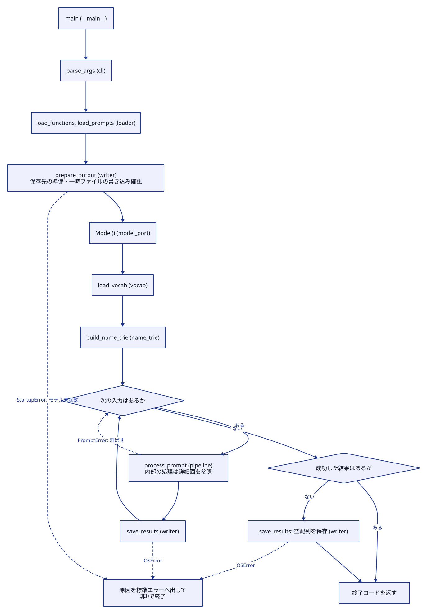
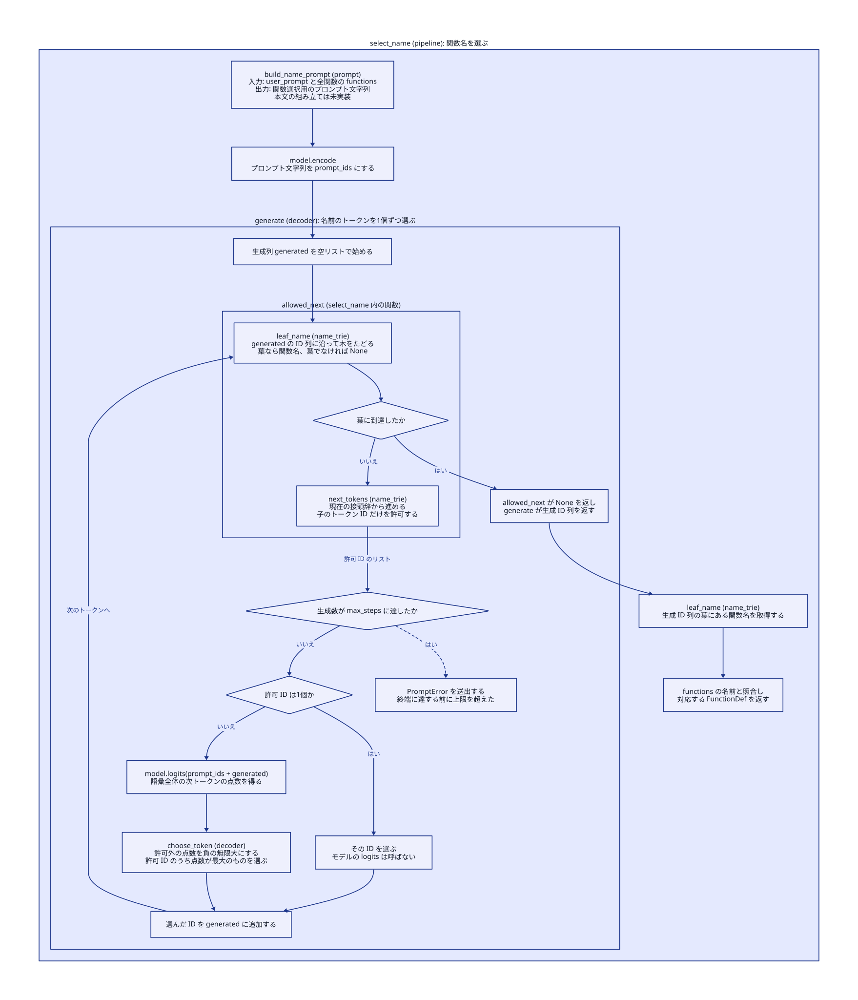
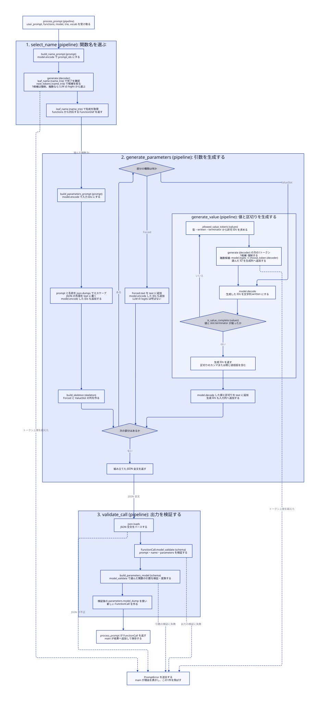
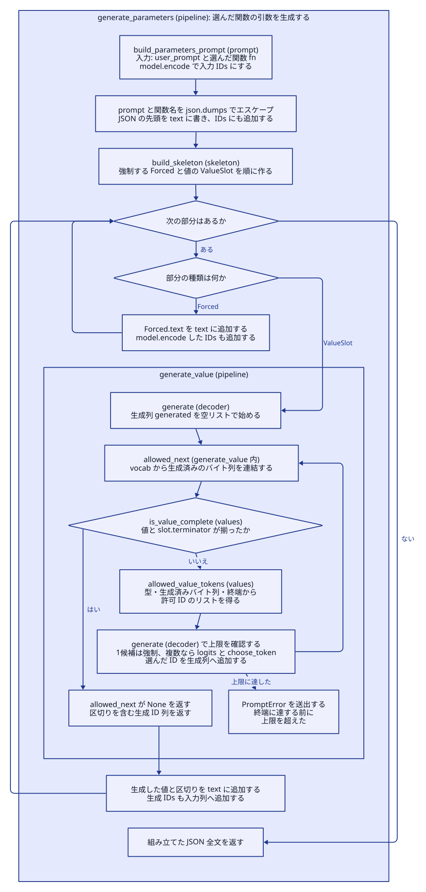

# 基盤実装の設計

この文書は、自然言語の依頼を関数呼び出しの JSON に変換する要求を、
どのデータと処理で実現するか説明する。現行設計の正本は本書であり、要件は
[Subject v1.7 の要約](subject-v1.7.md)とユーザーの指示に従う。
現行実装は§1〜8、新しい生成制御の未実装提案は§9、今回対象外の旧提案は§10に分ける。
実行結果は[検証記録](implementation-verification.md)を参照する。

開発用の[連続負荷・熱監視](superpowers/specs/2026-11-11-safe-thermal-survey.md)は、
CLIのthermal入口、親の安全監視、公開SDKだけを使う子の連続負荷、JSONL記録で構成する。
アプリ本体・SDKの実装は変更せず、温まる過程の調査とSubjectの実アプリ5分判定を分ける。

現行構造はローカルdevelopの`15f9ab2372e9b76a669f29c8edf0c65dc94915a4`で確認した（2026-11-13）。
本書に残っていた未実装のLF区切り方式は、現行のJSON区切り方式と区別して§10へ移した。
今回の変更は設計文書だけであり、生成ループや表示のコードは変更していない。

## 1. 要求から処理上の条件へ

利用者は、自然言語で書いた依頼について、用意した関数のどれをどの引数で呼べばよいかを知りたい。
このプログラムは関数呼び出しの記録を作り、対象の関数自体は実行しない。
関数名や引数の構成は実行時の定義に従うため、特定の関数セットの正解をコードに埋め込まない。

| 要求・要件と出典 | 処理上の条件 | 実現する設計 |
| --- | --- | --- |
| 自然言語から関数と引数を選ぶ。選択は LLM が行う（IV.3.1、V.1） | 説明と依頼をモデルに渡し、定義された関数を選び、その引数値を生成する | 関数選択と引数生成を別の段階にする（§3、ADR-0001・0002） |
| 関数定義と入力はレビュー時に変わる（V.2） | 名前・引数名・型を入力から取得し、実行ごとに生成と検証の条件を作る | 定義から名前の木、JSON の骨組み、引数検証モデルを作る（§2～4） |
| 入力の空配列はモデル起動前に入力不足のエラーとする（ユーザー、2026-11-10） | プロンプト配列に1件以上あることを入力検証で確認する | `load_prompts` が空配列を StartupError にし、モデル起動と出力更新へ進ませない（§2・5） |
| 出力先へ書けない場合はモデル起動前に終了する（ユーザー、2026-11-10） | 保存先の準備と実際の書き込み確認を入力検証の直後に行う | `prepare_output`が親ディレクトリを作り、同じ場所で一時ファイルの作成・書き込みを試す（§2・5、ADR-0007） |
| 桁区切り数値・引用符内の実改行を扱う旧提案 | 現行実装には適用しない | 未実装事項として§10へ分離。今回の生成制御変更には含めない |
| 重複キー・型の暗黙変換・数値の丸めを黙認しない（ユーザー、ADR-0017） | 解析前の値を保持し、構造と型を厳密に検証する | 共通JSONフック→strict Pydantic→数値保持検査（§2・3.3） |
| JSON の構文とスキーマを生成中に制約する（V.3.3、V.4） | 定義外の名前、キー、型、余分な文章を出力に入れない | 名前の木で候補を制限し、構造を強制し、値の接頭辞でトークンを制限する（§3・4） |
| エラーを処理し、原因を明確にする（IV.1、IV.3.1） | 起動の失敗、1件の生成失敗、保存失敗を識別して終了・継続を決める | StartupError、PromptError、保存の OSError を別の境界で扱う（§5） |
| 途中の成功結果を残したい（ユーザー、ADR-0007・0012） | 成功済みの出力を失敗した次の入力や途中書き込みで壊さない | 成功ごとに一時ファイルへ全成功結果を書き、置換する（§5） |
| 何が選ばれたかを見て調整したい（ユーザー、ADR-0014） | 入力と選択内容、生成中の引数、警告値を結び付けて表示する | 推論時の観察データを TUI へ通知する（§6） |
| 精度はパラメーターや部品ごとに改善したい（ユーザー、PR #44 の範囲） | プロンプトや選択・生成の変更を、保存や表示の処理から分けて検証できる | 変更箇所と受け渡すデータの契約を定める（§7） |

Subject の最終目標には正答率90%以上、JSON・型適合率100%、全テスト5分未満もある（V.5）。
基盤は生成条件の制約、失敗の通知、調整用の観察手段を提供し、正答率と時間は別々に測定する。
正答率90%を今回の基盤 PR の承認条件にはしない。測定で基盤の不具合が分かればレビュー対象にする。
5分目標について本書が示すのは、推論回数とマスク検査の量を抑える処理と、単独で時間を測る方法である。
対象入力・機材を含む最終的な達成判定は、基盤の処理契約の確認とは分けて行う。

## 2. 入出力と、起動時に準備するデータ

入力不備が原因の失敗を推論の失敗と混同しないため、ファイルを先に読み、検証してからモデルを起動する。
`main` は CLI のパスを `parse_args` で受け取り、`load_functions` と `load_prompts` を呼ぶ。
全ての所有JSON読み込みは`json_io.loads`へ集める。標準`json.loads`の`object_pairs_hook`で
各オブジェクトのキー重複を辞書への上書き前に拒否し、`parse_constant`でNaN・Infinityを拒否する。
小数は`parse_float=Decimal`で正確に読み、整数はintで受け取る。Pydanticの`validate_json`には
重複拒否の設定がないため、解析1回の後に`TypeAdapter.validate_python(..., strict=True)`で検証する。
関数定義には、空の関数一覧、空白だけを含む空の関数名・重複した名前、未対応の型、
必須フィールド欠落、余分なフィールド、不正な型を認めない。
空・空白の説明と引数名はPydanticの検証後に関数名・引数位置付きでlogging警告をstderrへ出し、
値をそのまま保持する。空のparametersは引数0個として認める。
入力JSONの配列を検証した後、`index_functions`が関数名をキーにする`dict[str, FunctionDef]`へまとめる。
重複は代入前に拒否する。辞書の挿入順を入力順として保ち、定義の一覧には`values()`、名前の一覧にはキーを使う。
プロンプトの配列には1件以上が必要で、空配列 `[]` は `load_prompts` が入力不足の StartupError にする。
この検証はモデル起動前に行い、既存の出力は変更しない（ADR-0012 の2026-11-10の変更）。

`Args`の`Path`型はパスの型を確認するだけで、実在や読み書き可否は検査しない。
入力はloaderが実際に読み、正常なら`prepare_output(args.output)`へ進む。
`prepare_output`は必要な親ディレクトリを作り、既存の出力先が通常ファイルか確認したうえで、
同じディレクトリに一時ファイルを開いて書き込み・flush・削除する。
パスの不備や書き込み失敗はStartupErrorにし、`Model()`を呼ばずに終了する。
既存出力の内容は変えず、出力ファイルがなければ確認時には作成しない。
入力検証に失敗した場合は、この出力先の準備も行わない。

| 境界を越えるデータ | 内容・条件 | 次の処理での用途 |
| --- | --- | --- |
| 関数定義のJSON配列 → `dict[str, FunctionDef]` | 関数名から定義への対応。重複を拒否し入力順を保持する | 値を選択肢の提示に、キーを名前の木に使い、選択後は名前で定義を直接取得する |
| 入力ファイル → `list[str]` | 1件以上。各要素の `prompt` は文字列。入力順を保持する | 1件ずつ処理し、同じ文字列を出力の `prompt` にコピーする |
| SDK → `Model` | 公開 API の encode、decode、logits、語彙ファイルのパス | モデルを使用する処理だけがこのラッパーを受け取る |
| 語彙ファイル → `dict[int, bytes]` | トークン ID と、そのトークンが表すバイト列 | 候補の追加で中間表現の型別文法が保たれるかを調べる |
| 関数名 → `NameTrie` | `encode(名前 + EOS)` の経路と、葉にある元の関数名 | 定義に存在する名前の経路だけを生成時に許す |
| 成功した1件 → `FunctionCall` | ちょうど `prompt`、`name`、`parameters` を持つ | 検証済みの呼び出し記録として保存する |

現在の設計が扱う型は `number`、`string`、`boolean`。関数定義の引数・戻り値とも、この3型で検証する。
これは対応範囲についての設計判断であり、Subject に型が3種類と明記されているわけではない（ADR-0004）。
型や JSON の構造を変えずに、関数名、引数名、個数、説明を変えられる。

モデルは起動時に一度読み込む。語彙と名前の木も、その実行の全入力で共有する。
語彙は `load_vocab`、名前の木は `build_name_trie` が準備する。
SDK の encode は Tensor を返すため、`Model.encode` が `tolist()` で普通の ID リストにする。
語彙の辞書は ID の意味を調べるもの、`tolist()` は SDK の戻り値の型を変えるものであり、用途が異なる。

## 3. 1件の依頼を呼び出し記録へ変える

`process_prompt` は、関数を選ぶ `select_name`、引数を作る `generate_parameters`、
生成した記録を確認する `validate_call` の順に進む。それぞれが次の段階へ渡すものを決め、
表示や保存のためにモデルの選択結果を作り直さない。



[全体図の D2](diagrams/skeleton-flow.d2)

1件の処理の現行の呼び出し順は§9.1に記す。既存の詳細図はLF方式の未実装案なので§10へ分離する。

### 3.1 関数の説明と依頼から、定義にある名前を選ぶ

「選択は LLM が行う」と「定義された名前だけを使う」を両立するため、
意味の選択にはモデルの点数を使い、名前として許す経路は入力された関数定義から制約する。

`build_name_prompt`は辞書の`values()`から全関数の名前・説明・引数名と型を入力順に列挙する。
利用者の依頼を添え、関数名だけを応答するよう指示する。`select_name`はこれをencodeし、`decoder.generate`に渡す。
生成中は `next_tokens` で現在の経路の子を取得し、その ID だけを次の候補にする。
名前とEOSの後ろの葉に到達したら`leaf_name`で元の名前を取得し、`functions[name]`で定義を返す。
読み込み時に作った辞書を使い、選択のたびに関数の配列を再走査しない（ADR-0016）。

名前の末尾には Qwen の応答終了トークン `<|im_end|>` を含める。コード上の名前は `EOS` とする。
例えば `fn_add` と `fn_add_numbers` が共存するとき、`fn_add` の後で EOS と `_numbers` の経路が分かれる。
未完成の名前では EOS を許さない。SDK の decode は特殊トークンを表示しないため、
終了は表示文字列ではなく ID の経路で判断する。生成上限は名前の木の最長経路から計算する。

名前選択はここで完了し、引数生成は別の入力列で始める。名前選択で生成した EOS は
引数値の生成列に流用せず、選んだ名前を最終出力の JSON 文字列として組み立てる。
EOS はユーザーが承認した暫定方式で、障害となった場合に見直す（ADR-0013）。



[select_name の D2](diagrams/select-name.d2)

### 3.2 決まったJSON構造と引数値を順に組み立てる（現行実装）

`generate_parameters`は引数用プロンプトをencodeし、promptと選択した名前を
`json.dumps`でエスケープしたJSON先頭を作る。この先頭をtextとモデル入力idsの両方へ追加する。
`build_skeleton(fn)`の要素を定義の順に処理する。

- `Forced`なら、そのtextを最終文字列へ足し、encodeしたIDもモデル入力へ足す。
- `ValueSlot`なら、引数名・型を通知して値表示とトークン数を初期化し、`generate_value`を呼ぶ。
  返るのは値と区切りを含むID列である。SDKの公開decodeで文字列へ変換してtextへ足し、ID列も入力へ足す。

`ValueSlot.terminator`は途中の引数なら`,`、最後の引数なら`}`である。
各値が自分の後ろの区切りを生成し、Forcedは同じ区切りを重ねない。最後にForcedで記録全体を閉じる。
引数が0個なら、空のparametersと閉じ括弧をForcedで書き、値の推論はしない。

例えばnumberのaとbなら、固定部分`"a": `、値`12,`、固定部分` "b": `、値`3}`、
記録を閉じる`}`の順になる。完成した値を別方式で正規化する処理は現在存在しない。
数値が単独で成立しても区切りが出るまでは続ける。`12`は`123`の途中かもしれないためである。

旧LF方式の図と説明は§10へ分離した。現行処理の説明にその図を使わない。

### 3.3 JSON と定義の両方で検証した値を保存へ渡す

生成後の検証は、構文制約と骨組みの実装に不整合があった場合の確認境界となる。
`validate_call` は全文を `json_io.loads` で読み、strictな`FunctionCall`で記録のキーと型を検証する。
`call.name`が選択済みの`fn.name`と完全一致することも確認し、不一致なら期待した名前と実際の名前を含むPromptErrorにする。
続いて `build_parameters_model` が選択済みの定義から作ったstrictなモデルで、必須引数、余分なキー、型を確認する。
内部のフィールド名とは別に元の引数名を保持し、`_private` や `model_dump` のような名前も出力に戻す。
numberはJSON整数・小数の両方を受け付けるが、bool・数値文字列・全角数字からの変換はしない。
booleanも整数・文字列から変換しない。これは構造化済みJSONの検査であり、依頼文の数値表現の解釈とは異なる。

JSON整数はintのまま保持する。小数・指数のDecimalには`validate_number`をPydanticの
BeforeValidatorとして適用し、有限のfloat候補を`json.dumps`→Decimalで再解釈して元の値と比較する。
一致ならfloatを使い、丸めがある整数値なら有限範囲内でintへ戻す。それ以外は精度損失エラーとする。
`0.1`はJSON再出力が一致するため受理し、二進数として厳密な表現は要求しない。
非有限値、オーバーフロー、非ゼロ値のゼロへのアンダーフローも拒否する。
戻り値には検証後の引数を入れ、標準JSON保存でnumber型を保つ。Decimalの文字列化や独自JSON出力器は使わない。

制限の根拠はPythonのint文字列変換の実行時上限、floatの有限範囲と再出力精度、既存の256トークン上限である。
小数・指数表記はfloat候補が有限である必要があり、巨大な整数表記と受理範囲が異なる。
長い小数は保存精度を保持できなければPromptErrorにし、正当な短い値に見せかけない。
これは実装上の制約であり、Subjectの追加要件とはしない。

語彙・測定fixture・環境調査・開発用入力チェックのJSONも同じ重複拒否・数値解析方針を使う。
配布SDK内部の解析は変更しない。LF方式を実装する場合にも、正規化後へこの値保持契約を適用する。

## 4. 候補トークンの判定と終了条件

`decoder.generate` は、生成済みの ID 列を終了・候補判定用の関数に渡す。
名前を選ぶ段階では木、値を生成する段階では型の文法を使い、同じループからそれぞれを呼ぶ。

1. 完了なら生成 ID 列を返す。上限ちょうどの位置で完了した場合も成功する。
2. 未完了で生成上限に達していたら、終端未到達を示す PromptError にする。
3. 続けられる候補がなければ PromptError にする。
4. 候補が1個ならその ID を強制する。複数なら logits を一度取得する。
5. `choose_token` が候補外を負の無限大にした点数列から最大の ID を選び、生成列へ追加する。

元の logits は変更しない。点数列の型・次元、NaN、正の無限大、許可候補がすべて非有限の場合を確認する。
値の上限は暫定256トークンで、未完了の値を切り詰めて成功扱いにはしない。
`generate_value` は失敗に引数名と型を付け、例えば「text の string 値が256トークンでも終端に達しない」と通知する。

### 値の文法とバイト列の扱い（現行実装）

`generate_value`内の`allowed_next`が、語彙から生成済みのバイト列を連結する。
`is_value_complete(written, slot.type, slot.terminator)`が真なら完了し、
偽なら`allowed_value_tokens`で次のIDを求める。トークン全体を加えた接頭辞が正当か確認し、
区切りを越えて次の値や余分な文章を含むトークンを拒否する。

| 型 | 許す値の形 | 完了条件 |
| --- | --- | --- |
| number | 符号付き整数・小数。桁区切り・先頭プラス・指数は生成しない | 有効な数値とスロットの`,`または`}` |
| string | JSONの二重引用符・エスケープ・UTF-8。引用符内の生の制御文字は拒否 | 閉じ引用符の後にスロットの区切り |
| boolean | 小文字のtrueまたはfalse | 完成した単語の後にスロットの区切り |

値の前後に文法が認める空白は許すが、区切り後の追加文字は許さない。
UTF-8の文字が複数トークンへ分かれるため、文法は文字列のdecode結果ではなくバイト列で判定する。
stringでは共通接頭辞の状態を一度求め、各語彙候補の追加分を検査する。
未完成UTF-8を保持するマスク処理と、表示用decodeで未完成文字を省く処理は別である。

## 5. 失敗と、保存する結果の扱い

Subject はエラー処理を求めるが、1件失敗した後の出力内容までは定めていない。
ここではユーザー承認済みの方針に従い、起動時エラーでは終了し、1件の失敗は記録して次へ進む。
成功済みの呼び出しを入力順に保持し、`save_results` は出力先と同じディレクトリの一時ファイルへ書いてから置換する。

| 発生した条件 | 継続と終了コード | 出力ファイル |
| --- | --- | --- |
| 不正な CLI 引数 | 推論前に終了、非0 | 書き換えない |
| 入力のプロンプト配列が空 `[]` | モデル起動前に入力不足の StartupError を表示して終了、1 | 書き換えない。出力ファイルがなければ作成しない |
| 出力先の準備・書き込み確認の失敗 | モデル起動前に出力先と原因を表示して終了、1 | 既存出力は保持し、確認用の一時ファイルを削除する。準備途中の親ディレクトリは残り得る |
| 入力・定義・モデル・語彙・名前の木の起動失敗 | StartupError を表示して終了、1 | 書き換えない |
| 1件の選択・値生成・検証の失敗 | PromptError と入力位置を表示して次へ進み、最終的に1 | 失敗した件は保存しない。成功があればその都度更新する |
| 1件以上の入力を処理したが全件失敗した | 1 | 今回の成功件数を表す `[]` を保存する |
| 保存失敗 | 原因と出力先を表示して直ちに終了、1 | 置換前の最後のファイルを保つ。後続の推論をしない |

要求上は各入力に1記録を作ることを目指すが、上限や失敗処理を設けるだけで全件の生成成功を
保証できるわけではない。成功した記録の構文・型の条件と、全入力が成功したかは分けて確認する。
SDK 呼び出しの例外は `Model` が起動時または1件の失敗へ変換する。
理由と検証範囲は ADR-0007・0012、および検証記録にある。
出力の事前確認は、その時点の一時ファイル作成・書き込みを確かめるもの。
後の状態変化や最終置換の失敗もあり得るため、保存時の例外処理は維持する。
出力先パスの最終要素がシンボリックリンクなら、その名前に新しい通常ファイルを保存し、
リンク自体を置き換えてよい。リンク先の内容は更新しない（ユーザー決定、ADR-0007）。

## 6. 選択を観察し、調整へつなげる

以下は現在の実装の説明である。今回の生成制御・表示境界の提案は§9に分離する。
過去の未承認案は採用根拠にせず、現行コードから比較した。

ユーザーがプロンプトや部品を調整するとき、どの入力のどの段階で何が選ばれたかを見られるようにする。
`decoder` は選択のたびに `TokenChoice` を任意の通知関数へ渡す。
`pipeline` は関数・引数・値の文脈を付け、`main` と `display` は入力位置と画面表示を担当する。
実行中に変わらないもの(モデル・語彙・関数定義・名前の木・通知関数)は `pipeline.Run` に
まとめて渡す。通知関数がなければ、`decoder` は診断値を計算しない。

表示するのは、入力番号、処理段階、依頼、選択済みの関数、現在の引数と型、生成中の値と、
トークン数である。候補ランキングは[ADR-0023](design/adr/0023-remove-token-ranking.md)に従い削除した。
トークンごとの途中経過の通知は維持する。候補表専用のlogit・allowed_mass・gapは計算しない。

名前選択で制約前のargmaxが採用IDと異なる場合は警告する。これは制約前の最大値がマスクされたことを示す。
該当関数なしとは判定せず、許可候補から最大のものを選ぶ。
警告に必要なraw_topのIDだけを同じlogitsから取得し、上位k件の取得やソートは行わない。
1候補の位置では追加推論をせず、forcedとして途中経過を通知する。
これらはプロンプト比較の補助情報であり、関数の正答率そのものではない（ADR-0011・0014）。

stderr が端末なら同じ領域を更新し、リダイレクト時は制御文字のない通常ログ(警告と要約)にする。
どちらも最後に、プロンプトごとに完了か失敗かと秒数を 1 行ずつ、最後に全体の行を残す(ADR-0021)。
端末のときは代替画面を出た後に書く。全体の時間はモデルの読み込みを含まない。
入力中の制御文字をエスケープし、終了・例外・中断時に端末状態を戻す。
診断表示用の decode が失敗したときは ID と取得不能の表示を使い、選択した結果を捨てない。
実際の値を組み立てる decode の失敗は、1件の生成失敗として扱う。
stderr への書き込みで OSError が起きたら表示を止め、生成と保存は続ける。

## 7. 部品の境界と、変更時に保つ条件

精度調整のためにモデルの呼び出し、文法、保存、表示を一つの処理へ集めず、
以下の受け渡しを保つ。実装は `src/` の直下に置き、モデルを差し替えるための抽象インターフェースは設けない。

| 調整・変更するもの | 主な担当 | 他の処理へ渡す条件 |
| --- | --- | --- |
| モデルへ与える説明・形式 | `prompt.py` の設定値と組み立て関数 | 名前段階・引数段階それぞれの文字列を返す。名前の応答形式は EOS の木と整合させる |
| 関数を選ぶ処理 | `pipeline.select_name`、`name_trie.py` | 入力された定義の `FunctionDef` を返す |
| トークンを選ぶ方法 | `decoder.py` | 渡された許可 ID から選び、生成列を返す。観察の有無で選択を変えない |
| 引数値の許可文法・終了条件 | `values.py`、`generate_value` | 値とスロットのJSON区切りのID列を返す。文字列の中の区切り文字では終了しない |
| JSON全文の組み立て | `generate_parameters`、`skeleton.py` | 値のdecode結果とForcedを最終文字列へ追加し、両方のID列をモデル入力へ継続する |
| 値の生成上限 | `pipeline.MAX_VALUE_STEPS` | 超過を値の短縮で隠さず、理由付きの PromptError にする |
| 引数の型と数値の扱い | `schema.py`、値の文法、保存 | 定義のキーを保持し、検証後の値を出力する。変更時は生成と検証の双方を確認する |
| SDK との接続 | `model_port.py` の具体的な `Model` | 公開 API だけを使い、encode と logits は普通のリスト、decode は文字列を返す |
| 表示とログの形式 | `display.py`、通知の整形 | 選択結果と保存データを変えない |

実装上の制約は、Python 3.10以上、型注釈・docstring、Subject の flake8/mypy の条件、
許可された依存関係、SDK の公開 API の利用である（Subject 要約 §1・3）。
検証するデータにはPydanticを使う。現行のModel・Dashboardは通常クラス、Runは通常dataclassである。
Subjectの全クラス要件についての解釈上の限界と、今回提案する検証境界は§9.6に記す。
SDKの既存のfloat32変更と復元手順は開発文書を参照する。

## 8. 要件を実現できているかの確認

以下は現行実装の確認条件である。§9・10の提案を検証済みという意味には使わない。

| 設計で確かめる条件 | 確認方法 |
| --- | --- |
| 入力変更から生成条件を作る | 入力・定義を変えた loader の直接テストと、変更関数セットの実モデル評価 |
| 名前から定義を取り出し、入力順と重複拒否を保つ | `test_function_registry.py`で辞書の順序、プロンプトへの掲載、固定logitsの選択、測定fixtureの重複拒否を確認 |
| 名前の接頭辞が衝突せず定義外へ進まない | `test_prefix_names_choose_end_or_continue` と木の直接テスト |
| 値の文法、UTF-8、区切りの境界を保つ | 現行JSON文法の直接テストで、値・スロットの区切り・UTF-8・終端越えを検査する |
| マスクと強制が指定どおりに働く | 固定 logits で候補外の最大値を排除し、1候補の推論省略と上限ちょうどの終了を確認 |
| 任意の引数名と検証後の型を保持する | `test_arbitrary_parameter_names_survive_validation` と欠落・余分なキー・非有限値の直接テスト |
| 失敗時の出力契約を保つ | 一時ファイル、置換失敗、部分成功、空配列の起動時エラー、全件失敗のテスト |
| 出力先の不備で不要なモデル起動をしない | `test_output_preflight.py`でディレクトリ・権限・パス・flush失敗を調べ、モデル未起動と出力保持を確認 |
| 観察で結果を変えず、端末を戻す | 通知あり・なしの比較、診断 decode 失敗の回帰テスト、疑似端末の実行 |

テストの所在は [アプリケーション](../tests/test_application.py)、[文法と木](../tests/test_constraints.py)、
[端末表示](../tests/test_terminal_progress.py)、[処理全体の制御](../tests/test_skeleton_flow.py)。
出力先の早期確認は[起動前の出力先検査](../tests/test_output_preflight.py)にある。
辞書の受け渡しは[関数名と定義の対応](../tests/test_function_registry.py)にある。
実モデルの精度、時間、測定しなかった条件は検証記録に分けて残す。
この表は確認すべき条件と方法を定めるもので、各検査を実行した結果は検証記録を参照する。

本実装のレビューでは、各処理がこの条件を守り、部品の調整を観察・検証できるかを確認する。
EOS、暫定上限、数値の精度、未対応の型などを変更するときは、要件と本書の該当箇所を見直す。

D2図はTUIへの通知と整形を省略している。§3.1の名前図は現行の共通ループ、
§10のLF方式の図は未実装の旧提案を示し、§9の案Aを実装済みと示す図ではない。
配色は [workflow-style.d2](diagrams/workflow-style.d2)、生成方法と余白の指定は各 D2 ソースにある。

## 9. 未実装提案：明示的な生成ループと1トークン選択（承認待ち）

この節は2026-11-12の依頼と2026-11-13の再検討指示に対する提案であり、§1〜8の現行実装を変更したものではない。
案Aの基本方針は承認済み。766e3beを対象としたインターフェースレビューにより、以下の具体的な契約は再提案であり実装承認待ちである。
前案の選択関数への上限管理、pipelineのDashboard直接依存、RunとDashboardでの一括strict検証は撤回する。
過去の未承認案・履歴文書を根拠に採用せず、現行コード・Subject要約・既存テストから比較した。
ランキング、LF方式、プロンプト調整、Dashboard全体の状態モデル再設計は対象外とする。

### 9.1 現行の呼び出し順と隠れた依存

```text
main → _start → 入力検証・出力準備 → Model・語彙・名前の木・Runの構築
     → Dashboardをwithで開始 → run.report = dashboard.report
     → _process_all → 入力とpromptをRun.sayで通知
       → process_prompt
         → select_name → プロンプトencode → decoder.generate
           → allowed_next → leaf_name / next_tokens
           → 上限・空候補確認 → forced または next_logits → choose_token
           → generatedへ追加 → observed → Run.say → Dashboard.report
         → generate_parameters → プロンプトとJSON先頭をencode
           → build_skeletonの順にForced / ValueSlotを処理
           → generate_value → decoder.generate
             → allowed_next → bytes連結 → is_value_complete / allowed_value_tokens
             → 共通の選択・追加 → observed → Run.say → Dashboard.report
           → 値をdecodeし、textとidsへ追加
         → validate_call → JSON解析・FunctionCall・引数モデルの検証
       → 成功ごとの保存 → 成功または失敗を通知
     → Dashboard終了 → 端末復帰・要約 → 終了コード
```

両方の`allowed_next`はNoneで完了、listで継続を表す。decoderはどの文法を処理しているか知らない。
コールバックは許可IDを返すものと、選択後の副作用を持つものに分かれ、役割は同じではない。

| 箇所 | 役割・入力・出力 | 外側から暗黙に読むもの・副作用 |
| --- | --- | --- |
| select_name.allowed_next | 生成ID列→完了または許可ID | ローカルtrie。木の照会のみ |
| select_name.observed | TokenChoice→戻り値なし | runのmodel・vocab・report。表示用decode、警告整形、stderr通知 |
| generate_value.allowed_next | 生成ID列→完了または許可ID | ローカルvocabとslotの型・区切り。バイト列を再構成して文法検査 |
| generate_value.observed | TokenChoice→戻り値なし | vocabとrun。UTF-8表示文字列と件数の整形、stderr通知 |
| decoder.next_logits | 入力ID列→logits | 通常はModel.logitsの束縛メソッド。クロージャではないが推論先の間接化である |
| Run.report / say | label・text→戻り値なし | mainが後から代入した通知先。生成制御ではなく表示資源への間接経路 |

現行のループは、`generate`から判定関数へ戻り、また`generate`から観測関数へ戻る。
呼び出し元を読むだけでは、完了・上限・推論・追加・通知の実行順が並んで見えない。
TokenChoiceは現在観測時だけPydantic検証され、生成ID列のcopyも観測時だけ作られる。
名前警告でしか使わないraw_topは、現状では観測付きの値生成でも計算されている。

### 9.2 共通処理と段階固有の処理

| 処理 | 名前の生成 | 値の生成 | 提案する所有者 |
| --- | --- | --- | --- |
| プロンプト・初期ID | 関数一覧から名前用入力 | 選択関数と固定JSONを含む入力 | 各pipeline関数 |
| 終了判定 | leaf_nameでEOS後の葉を確認 | バイト列とslot.type・terminatorでis_value_complete | 各ループに直接記載 |
| 許可ID | next_tokens | allowed_value_tokens | 各ループに直接記載 |
| 生成上限 | 木の最長経路 | MAX_VALUE_STEPS | 各ループ。終了確認後、選択前に確認 |
| 空候補・forced・モデル呼び出し | 同じ順序 | 同じ順序 | 共通の1トークン選択関数 |
| 負の無限大マスク・argmax・不正logits拒否 | 同じ | 同じ | 既存choose_tokenを維持 |
| 生成列への追加 | 名前のローカル列 | 値のローカル列 | 各ループに直接記載 |
| 結果の解釈 | 選択FunctionDefを返す | 値とJSON区切りのID列を返す | 各pipeline関数 |
| エラーの文脈 | 名前生成のエラー | 引数名・型を付けたPromptError | 共通エラーを各段階で扱う |
| 診断値の取得 | 表示が利用可能なときだけraw_topを要求 | 診断を要求しない | 共通の1選択関数内で要求時だけ計算。名前ループはIDを受け取る |
| 文字列整形・描画 | 名前の途中と制約警告 | 値の途中とトークン数 | display。生成側はIDと既存の型付きデータだけを渡す |

### 9.3 案Aの基本構造（承認済み）

名前と値の各ループが、完了・許可集合・上限・追加・通知を通常の呼び出し順に管理し、
1トークンのforced/推論/制約付きargmaxだけを共通化する。短い上限チェックの重複は許容する。
比較した案Bは、共通ループへ木またはslot/vocabを渡して分岐する方式である。
ループ自体は1箇所にできるが、2つの文法・終了・表示の文脈を共通制御へ集める必要があるため、
今回の順読みを優先して案Aを選ぶ基本方針が承認された。
以下はその基本構造を再選択する比較ではなく、具体的な3インターフェースの承認前レビューである。

### 9.4 選択完了時に返す情報の比較と結論

比較の基準は、呼び出し元が次のIDと必要な診断だけを扱い、推論に使った分布を所有しないことである。
Vを語彙数とする。下表の費用は既存choose_tokenの数値検査・負の無限大マスク・argmaxに追加される分だけを示す。

| 方式 | 責務・型・呼び出し元 | 追加計算・配列操作 | メモリ・forced | 判断 |
| --- | --- | --- | --- | --- |
| 案1：採用IDと全logits | tuple[int, list[float] \| None]。分布の利用・寿命・診断計算がpipelineへ漏れる | 名前観測時だけraw argmaxを計算できる。返却自体に配列操作は不要 | 同じlistへの参照ならcopyなし。ただしV個の分布が呼び出し元まで生存する。forcedはNone、推論なし | 前案。診断1値のための公開範囲が広いので撤回 |
| 案2：採用IDと必要な診断ID | tuple[int, int \| None]。選択時点で得た事実だけを返し、警告文は作らない | 要求時だけraw argmaxを1回計算。値生成と表示なしでは省く | 戻り値は定数サイズ。分布を外へ保持しない。forcedは要求があっても診断なし | 推奨。診断要求を表すキーワード引数を1つ認める |
| 案3：採用IDのみ | intだけなら明瞭。ただし正確な警告には同じ推論の情報を別経路で残す必要がある | 名前用の別選択APIと共有内部処理なら追加forwardなしで成立するが、関数の段数が増える | 戻り値は最小。Model.last_logits等の副経路は隠れた可変状態を増やす | 警告が必要な現仕様では採らない。2回目の推論で補う案も採らない |

案3で警告が原理的に不可能と主張するものではない。名前用APIだけ診断を返し、値用APIはIDだけ返す構成も成立する。
ただし、その2入口を同じ内部処理へ接続する追加の関数より、案2の明示的な計算要求1つの方が追いやすい。
採用IDからだけでは、制約前の最大IDがマスクされたかを復元できない。

最終提案は3つの必須引数に、意味を限定したキーワード専用引数を加える。

```python
def select_next_token(
    model: Model,
    ids: list[int],
    allowed: list[int],
    *,
    include_raw_top: bool = False,
) -> tuple[int, int | None]: ...
```

include_raw_topは「この推論の制約前argmaxを取得する」という計算要求である。
段階名、表示モード、Dashboard、上限、生成列の更新を選択関数へ渡す引数ではない。
前回は3引数だけに絞るため全logitsを返したが、今回は小さな計算要求と小さな戻り値を優先する。

- 空候補なら現在と同じPromptErrorにする。1候補ならそのIDとNoneを返し、推論・配列変換・診断を一切しない。
- 複数候補ならModel.logits(ids)を1回だけ呼び、既存choose_tokenで採用IDを決める。
- include_raw_topが真の場合だけ、同じlogitsからnp.argmaxでraw_topを取得する。選択には使わない。
  返すのは(token_id, raw_top_id)であり、logits自体や生成履歴は返さない。
- 偽なら(token_id, None)。Noneは「未計算」を意味し、forcedであることや0点を意味しない。
  呼び出し元がforcedを知る必要があればlen(allowed) == 1で分かる。現在の画面に新しいforced表示は足さない。
- 終了・上限・prefixの連結・生成列への追加・文字列整形・保存はこの関数の責務に含めない。

Pythonのlogits listに対するnp.argmaxは、一時的なNumPy配列への変換とO(V)の走査を伴う。
現行の診断も同じ操作をしている。名前の観測時に限って残し、値生成・表示なしでは追加の走査と配列を作らない。
choose_token内部の検査用配列の再利用まで同時に最適化せず、その純粋関数と同点規則を維持する。
戻り値は2つのスカラーで、logitsのcopyや保持は不要になる。追加forward・softmax・上位k件はどの段階にもない。

TokenChoiceのstep・tokensは選択結果ではなくループの進捗であり、選択関数の戻り値には含めない。
新しい選択クラスも作らない。既存TokenChoiceは廃止する。ループはgeneratedだけを所有し、
件数はlen(generated)から取得するので、重複するstep状態も保持しない。

### 9.5 GenerationProgressの必要性と最小契約

表示と生成の分離には、依存先を隠すことではなく、渡すデータと呼び出し先の責務を限定する必要がある。
mainが具体的な表示を接続する方向を維持し、次を比較した。

| 方式 | 実行順と依存の追いやすさ | 代償・Subjectとの関係 | 判断 |
| --- | --- | --- | --- |
| 案1：GenerationProgress型契約 | pipelineからdisplayへのimportを外し、5つの意味の決まった同期呼び出しだけを公開する。mainでDashboardとの接続が見える | Protocol宣言を1つ維持する必要がある。型宣言もPythonのクラスである点を無視できない | 推奨。端末・書式変更の依存を限定する目的に範囲を絞る |
| 案2：具体的な進捗表示オブジェクト | Dashboardを明示的に渡せば実行先は最も直接的。メソッド自体は案1と同じにできる | 新しい型宣言は不要だが、pipelineが端末クラスへ依存する | 成立する最小の代替案。型契約のコストを認めない場合はこちら |
| 案3：最小データだけを共有バッファ等へ渡す | 生成側はデータの保存だけを行える | 同期ループ中に別の誰が描画するかを解決する必要があり、スレッド・ポーリング・配送・復帰管理が増える | 単一の同期画面には不採用。戻り値で後から表示するだけではリアルタイム性を失う |

GenerationProgressは汎用report(label, text)を持たない。許可集合・次トークン・終了を返すメソッドも持たない。
stageは画面の任意フィールド名ではなく、既存の3段階に限定した意味上の値である。
名前と値の進捗も別々の契約にし、labelの文字列でデータの意味を切り替えない。

以下は型契約の宣言案であり、今回実装したコードではない。StageはLiteralの型別名であって新規クラスではない。

```python
Stage = Literal["select_name", "generate_parameters", "validate_call"]

class GenerationProgress(Protocol):
    @property
    def available(self) -> bool: ...

    def stage(self, stage: Stage) -> None: ...

    def function_selected(self, name: str) -> None: ...

    def parameter_started(self, name: str, param_type: ParamType) -> None: ...

    def name_token(self, tokens: Sequence[int], raw_top: int | None) -> None: ...

    def value_token(self, written: bytes, step: int) -> None: ...
```

| 呼び出し | 呼び出す場所と時点 | 最小データと表示側の担当 |
| --- | --- | --- |
| stage | process_promptで名前選択・引数生成・検証に入る直前 | 段階だけ。引数生成開始時に名前の途中表示を消す処理はdisplay |
| function_selected | select_nameで木の葉から名前が確定した時 | 名前だけ。確定した関数名の表示と強制再描画 |
| parameter_started | generate_parametersでValueSlotの生成に入る前 | slot.nameとslot.typeだけ。表示しないterminatorやValueSlot全体は渡さない |
| name_token | select_nameでID追加後 | SDKで途中の名前をdecodeするためID列が必要。末尾IDとraw_topで警告を整形する |
| value_token | generate_valueでID追加後 | 語彙から連結した生bytesとlen(generated)。値表示と件数に不要なID列・slot・logitsは渡さない |
| available | 名前選択前と各通知前に読む | 既存の診断ストリームが利用可能か。生成の完了・継続の返答には使わない |

値のwrittenは、現在observedで行っているvocabの連結をループ側へ移して作る。
バイト列の取得は生成済み内容の観測であり、UTF-8の表示用decode・repr・桁揃え・端末制御ではない。
観測時だけ作り、既存のバイト列連結回数を増やさない。逐次キャッシュする新しい状態も導入しない。
名前はSDKの公開decodeと特殊トークンの扱いを保つためID列を渡す。単純なvocab連結へ統一しない。

受信メソッドは同期で、生成列を書き換えたり保持したりせず、その場で表示文字列へ変換する。
Sequenceは静的に読み取り専用の操作を示すだけで、listを実行時に不変化する型ではない。
実装するDashboardが変更しないことをテストし、非同期キュー用snapshotは作らない。
SDKのdecodeでlist化が必要な分だけコピーし、旧TokenChoice用copyより増やさない。
全メソッドの戻り値はNoneなので、受信者が採用ID・許可集合・継続指示を返す契約にはならない。

progress.pyはこの型宣言とschemaのParamTypeだけを参照し、pipeline・display・decoder・SDKをimportしない。
DashboardはProtocolを継承せず、必要なメソッドを持つことで構造的に適合する。
mainがDashboardをwithで作り、同じオブジェクトをGenerationProgressとしてpipelineへ渡す。
登録処理・イベントバス・Observer階層・Callable・実行時のisinstanceによるProtocol検査は追加しない。

Dashboardはtotal・Model・vocabを構築時に受け取る。Modelとvocabは公開decodeと警告用トークン表記だけに使い、
モデル推論・設定変更は行わない。警告文・repr・UTF-8の途中の表示・制御文字のエスケープはdisplayに集約する。
mainからの入力番号・成功/失敗、fields・集計・計時・描画間隔・context managerによる復帰は維持する。
pipelineの_token_text・_decodedはdisplayへ移す。Dashboard全体を作り直す提案ではない。

### 9.6 Run廃止後の引数をどう管理するか

引数数を揃えるための全依存コンテキストは作らない。以下は最終提案における直接利用と転送の区別である。
user_prompt、fn、slot、idsは処理対象であり、それ以外を依存として数える。

| 関数 | 自身で直接利用する入力・依存 | 下位へ転送する依存 | 合計引数と判断 |
| --- | --- | --- | --- |
| process_prompt | progressで段階を通知。返されたfnとtextをvalidate_callへ渡す | user_prompt・model・vocab・functions・trieを必要な下位へ転送。progressも転送 | 6。調停役の依存として明示し、検証や選択のロジックは重ねない |
| select_name | user_promptとfunctionsで入力を作り、modelでencode、trieで完了/候補/上限を確認、functionsから定義を取得、progressへ通知 | modelを1選択関数へも渡す | 5。vocab・slot・出力先を受け取らない |
| generate_parameters | user_prompt・fn・modelでプロンプト/JSON/Forcedを処理し、progressへ引数開始を通知 | vocabはgenerate_valueへの転送のみ。model・progressも渡す | 5。値生成を含む処理なのでvocabの転送は必要 |
| generate_value | slot・ids・vocabで完了/候補を求め、progressへbytesと件数を渡す | modelは1選択関数への転送のみ | 5。functions・trieは不要 |
| select_next_token | modelで推論、idsをその入力に使用、allowedで空候補/forced/選択、include_raw_topで診断計算を選ぶ | なし | 必須3＋任意1。生成履歴・上限・表示先を受け取らない |

| 構成 | 利点 | 欠点と判断 |
| --- | --- | --- |
| 明示引数＋依存はキーワード専用 | 各段階が必要なものだけ受け取る。転送も呼び出しの行で確認でき、同じdictの取り違えを避けやすい | process_promptは6引数になるが、最終コードを縦に揃えて読める。推奨 |
| model/vocab/functions/trie/progressをContextへ再集約 | 呼び出しは短い | Runの再作成となり、使わない依存を全関数へ渡す。採らない |
| functionsとtrieだけをCatalogへまとめる | 両方を一体として作り/切り替える不変条件を持つなら合理的 | 現状は起動時の1セットのみ。引数削減のためだけにモデル・検証・作成経路を増やさない |
| 生成セッションが全依存と生成状態を保持 | 複数操作で生成を中断/再開し状態を共有するなら有用 | 現仕様は同期呼び出し内で完結。生成列の所有が曖昧になり、通常クラスと検証方針も増えるので採らない |

process_promptからの転送をなくすためにサービスロケータやモジュール変数を使わない。
型別名はコードを短くする目的だけでは追加せず、既存のdictとModel・NameTrieをそのまま使う。
既に検証済みの依存を引数へ展開しても、新しいPydantic検証の境界にはならない。

### 9.7 最終提案の型付きシグネチャ

以下は承認後のAPI案であり、現行APIではない。処理対象を位置引数、依存と計算要求をキーワードで明示する。

```python
def process_prompt(
    user_prompt: str,
    *,
    model: Model,
    vocab: dict[int, bytes],
    functions: dict[str, FunctionDef],
    trie: NameTrie,
    progress: GenerationProgress | None = None,
) -> FunctionCall: ...

def select_name(
    user_prompt: str,
    *,
    model: Model,
    functions: dict[str, FunctionDef],
    trie: NameTrie,
    progress: GenerationProgress | None = None,
) -> FunctionDef: ...

def generate_parameters(
    user_prompt: str,
    fn: FunctionDef,
    *,
    model: Model,
    vocab: dict[int, bytes],
    progress: GenerationProgress | None = None,
) -> str: ...

def generate_value(
    slot: ValueSlot,
    ids: list[int],
    *,
    model: Model,
    vocab: dict[int, bytes],
    progress: GenerationProgress | None = None,
) -> list[int]: ...

def select_next_token(
    model: Model,
    ids: list[int],
    allowed: list[int],
    *,
    include_raw_top: bool = False,
) -> tuple[int, int | None]: ...

def choose_token(
    logits: Sequence[float], allowed: Collection[int],
) -> int: ...
```

表示の具体クラスの構築案は`Dashboard(total: int, model: Model, vocab: Mapping[int, bytes])`で、
__init__の戻り値はNone。progressはmainが渡すこの1インスタンスであり、Protocolのインスタンスは作らない。

### 9.8 実行順序・状態・依存方向

```text
main：入力検証・出力準備 → Model → vocab → trie → Dashboardをwithで開始
  → _process_all → process_prompt
    → stage(select_name) → select_name
      → 名前用入力をencode → 名前のループ
      → function_selected → FunctionDefを返す
    → stage(generate_parameters) → generate_parameters
      → 引数用入力・JSON先頭をencode → Forced / ValueSlotを定義順に処理
      → parameter_started → generate_value → 値のループ → ID列を返す
      → 値を最終decodeしtextと入力idsへ追加
    → stage(validate_call) → validate_call → FunctionCallを返す
  → 成功ごとに保存 → 成功/失敗通知 → 次の入力
with終了：端末復帰 → 要約 → mainの終了コード
```

各生成ループは次の順を明記する。

1. 名前はleaf_name、値は語彙バイト列とis_value_completeで終了を確認する。完成なら返す。
2. next_tokensまたはallowed_value_tokensを直接呼ぶ。
3. ループ自身でlen(generated)と名前/値それぞれの上限を比較する。
4. 必要な入力idsを準備する。複数候補のときだけprefix_ids + generatedを作り、0/1候補ならprefix_idsを渡す。
5. select_next_tokenを通常呼び出しする。名前はprogressが利用可能なときだけinclude_raw_top=True、値は常にFalse。
6. 採用IDをgeneratedへ追加する。
7. 進捗が利用可能なら名前はID列とraw_top、値は連結したbytesとlen(generated)を対応メソッドへ渡す。
8. 次の反復へ進む。値のPromptErrorには現在どおり引数名と型を付ける。

終了→許可候補の計算→上限→空候補→forced/推論の順を変えない。
上限ちょうどで完成すれば成功し、上限と空候補が同時なら上限エラーを優先する。
forcedでは新しいモデル入力listもlogitsも作らない。制約マスク・argmax・同点規則は既存choose_tokenを維持する。
最終値のdecode失敗は生成失敗。診断decode失敗は現行の取得不能表記、stderrのOSErrorは表示停止として扱う。
中断は握りつぶさず、withで端末を戻す。progress=Noneでも選択・入力・forward回数は同じである。
リダイレクトは警告を残すため、isattyだけで名前診断を止めない。

| 状態・副作用 | 所有者 |
| --- | --- |
| モデル資源、語彙、関数定義、名前の木 | mainで構築し共有。各関数は設定や辞書を変更しない |
| 名前/値の生成済みIDと上限 | 各select_name / generate_valueのローカル変数。stepは独立保存しない |
| 引数全体のモデル入力idsと最終text | generate_parameters |
| 1回のlogits、採用ID、要求時のraw_top | select_next_token。logitsは関数外へ公開しない |
| モデル推論 | select_next_token内のModel.logits、分岐で1回だけ |
| 表示のfields・計時・成功/失敗の集計・端末資源 | Dashboard。生成列や選択の権限を持たない |
| JSON検証と保存 | validate_callとmain側のsave_results。表示は保存結果を変更しない |

```text
main ──→ pipeline ──→ decoder ──→ model_port
  │          └──→ progress（型契約。schemaのParamTypeだけを参照）
  └──→ display ──→ model_port
```

pipelineからdisplayをimportせず、displayからpipeline/decoderをimportしない。
型の接続はmainの呼び出しでmypyが確認し、実行は通常の同期メソッド呼び出しで追える。
生成は受信者の返答によって終了・継続せず、汎用Callable・クロージャ・イベントバス・ジェネレータを使わない。
_startはArgs・prompts・functionsまでを返し、mainで残りの準備を明示する。巨大な資源tupleを作らない。

### 9.9 Pydantic：既存の検証境界と確認できる限界

| データ・フィールド | 検証場所と目的 | この提案で追加する検証 |
| --- | --- | --- |
| CLIのパス | cli.ArgsのPydanticモデル。存在と書込可否はloader/writerで実際に確認 | なし |
| promptsの要素 | load_promptsのTypeAdapterをstrict実行。str・キー・空配列拒否 | なし。totalはその件数から導出 |
| functionsの各FunctionDef | load_functionsのstrict検証とindex_functionsの空/重複拒否 | なし。辞書とモデルを再検証しない |
| vocabのID・バイト列 | load_vocabで元JSONをstrict検証し、非負・一意・バイト変換を確認 | なし。完成した辞書を再走査しない |
| trie | build_name_trieの既存NameTrie構築とEOS衝突検査 | なし。完成した木を再構築しない |
| ValueSlot | build_skeletonの既存Pydanticモデル構築 | なし。表示へ渡すname/typeを別モデルに包まない |
| SDKのlogits | choose_tokenの次元・数値変換・非有限値・許可ID検査 | なし。分布へのPydantic走査を追加しない |
| 最終FunctionCallと引数 | validate_callのJSON・strict型・数値保持・スキーマ検証 | 既存の必須検証を維持。生成制約とは別の確認境界 |
| Dashboardのtotal・model・vocab | 検証済み入力の件数、mainが構築したModel、検証済み語彙への参照 | なし。新しい外部入力ではなく、辞書copyやInstanceOfは足さない |

RunとTokenChoiceは廃止する。代わりのデータクラスやContextを作らず、内部の採用IDと任意の診断IDはtupleで返す。
型注釈はSDKハンドルの実動作を保証しない。InstanceOf[Model]もラッパーの型一致しか調べないため、
ロード・encode/decode・logitsの保証として追加せず、既存Modelの例外変換と回帰試験で確認する。

新しいクラス宣言はGenerationProgressだけである。その目的は静的な表示用の契約で、検証対象の入力や状態は持たない。
ただし「型検査専用だからPythonのクラスではない」とは解釈しない。typing.Protocolから派生した宣言も
Pythonではクラスオブジェクトを作る。Protocol自体は直接インスタンス化できず、今回は実装クラスの継承も要求しない。
この性質はローカルPythonでも確認した。ProtocolはPydanticによるデータ検証の代わりにはならない。

| 確認できる事実 | そこからは断定できないこと |
| --- | --- |
| Subjectの明文は「All classes must use pydantic for validation.」 | 型契約や検証入力を持たない資源クラスを例外扱いできるとは明記されていない |
| ModelとDashboardは現行コードでも通常クラスで、コンストラクタにPydanticの呼び出しはない | loaderによる検証だけで、この明文の評価を必ず満たすとは断定できない |
| Protocolの宣言もPythonのクラスであるが、実行時のデータモデルではない | 宣言だけならSubjectの対象外だという採点上の保証はない |

推奨案は「実際のデータを入力境界で検証し、検証対象を持たない型契約や資源に架空の検証を足さない」という解釈に立つ。
これは人間の承認を求める解釈であり、要件への適合を検証済み・解決済みとは記録しない。
全クラス宣言への個別適用を求める場合は、案2の具体的Dashboardを渡す構成なら新規Protocolの論点を避けられる。
ただし、その場合も既存Model・Dashboard・例外クラスの解釈リスクは残る。
BaseModelとの多重継承、無意味なvalidate_call、SDKハンドルを入れるためだけのarbitrary_types_allowedで見かけ上対応しない。

### 9.10 実装後の検証と今回の承認対象

承認後はテスト先行で次を確認する。既存generate/Run/TokenChoice向けテストは削除するだけで済ませず、守っていた契約を新APIへ移す。

- 固定logitsで採用ID・SDK入力・forward回数・入力列の非破壊が前後一致する。
  include_raw_topの真/偽で採用IDは変わらず、値生成・表示なしは診断計算0回、名前観測の分岐は1回、forcedは要求があっても0回。
  Noneをforced判定や0点に誤用せず、同点・NaN・正負無限大・不正配列も既存規則で確認する。
- 名前と値の両方で終了/上限/空候補の優先順、0・1・255・256・上限超過、EOS、UTF-8と区切り越えを確認する。
  名前→値の順序、Forcedと全引数のids継続、JSON構造・strict型・数値保持を確認する。
- 名前警告の出る/出ない、特殊トークンと未完成UTF-8の取得不能表記、値bytesの表示、件数と引数表示、
  完了・失敗・中断・リダイレクト・stderr故障・端末復帰・途中保存・保存失敗を確認する。
  表示の受信メソッドが生成列を書き換えず、選択に影響しないことも確認する。
- mypyでDashboardからGenerationProgressへの構造的適合と、全依存のキーワード呼び出しを確認する。
  現行と同じloader/outputの検証だけを使い、Run/Dashboardや各トークンに重複検証を足さない。
- 実行環境でGPUを確認し、make gpu-runで同じ固定入力の前後JSONをcmpとスキーマで比較する。
  意味精度の試験と、表示あり/なしの単独計時を分け、起動時間・全時間・ばらつきを記録する。
  モデル推論回数の一致だけを実時間やSubjectの5分制約への適合とは扱わない。
- make install、make lint（flake8とSubjectの必須mypy）、make test、差分レビューを行う。

今回の承認対象は、必要な診断IDだけを要求時に返す選択API、上記5メソッドとavailableの型契約、
関数ごとのキーワード依存、既存入力境界での検証である。案Aの基本構造は承認済みだが、この具体化の実装は未承認である。
上位k件・新規依存・生成方式の変更は含めない。性能・Subject解釈の限界を含めて人間の承認を求める。

この改訂の確認結果（2026-11-13）: make install成功、flake8と必須mypy成功（45ソース）、既存188テスト成功。
設計レビューで重大な不整合なし。型付きシグネチャの構文と表の列数、変更範囲も確認した。
docs/architecture.mdの§9だけを変更し、コード・テストは未変更、ADRは参照も変更もしていない。
提案のAPIの回帰・性能試験は実装前なので未実施である。

## 開発専用のプロンプト改善

[ADR-0018](design/adr/0018-local-prompt-experiments.md)の実験ツールは、提出アプリの外側で
指示文2つだけを差し替えて、既存の関数選択・生成・検証・CLIを評価する。
モデルの改稿と採点・Git同期・CPU測定・追加集合の開封を分け、制御側が後者を固定する。
SDK・生成方式は変更せず、実験ツールと開発環境は提出対象に含めない。


## 10. 今回対象外の旧提案：LFで区切る引数値（未実装）

この節は、本書に混在していた旧提案を現行設計から分離して保存したものである。
今回のクロージャ・コールバック見直しに含めず、採用・実装・性能を承認済みとは扱わない。
コードは現在も§3.2・4のJSON区切り方式である。以下の未来形・設計判断は旧提案の記述である。
関連する履歴ファイルは今回参照・変更していない。



[旧process_prompt図のD2](diagrams/process-prompt.d2)

### 10.1 旧提案の組み立て方

この節は[ADR-0015](design/adr/0015-value-records.md)の改行区切りを反映した設計で、コードは未変更。
モデルが読む値の中間表現と、保存するJSONの構造を分ける。

出力のキーと引数の名前・順序は既に分かっているため、`generate_parameters` はモデルにその構造を
選ばせる必要がない。入力の `prompt` と選択済みの名前を `json.dumps` でエスケープし、記録の先頭を作る。
`build_parameters_prompt`には選んだ1関数の定義と依頼、引数の順序を入れ、
関数を実行せず、値だけを引用符外のLFで区切って出すよう指示する。
引数生成用の入力は一度だけencodeし、複数の引数を同じ応答の続きとして生成する。
`PARAMETER_EXAMPLES`（既定は空）に例があれば、systemと依頼の間に会話の組（user: 定義と依頼、
assistant: 骨組みと同じ書き方の答え）として置く（ADR-0020）。空なら従来と同じ文字列になる。

その後の構造は `build_skeleton` が定義から作る。固定文字列を `Forced`、値を生成する場所を
`ValueSlot(name, type)`で表す。`Forced`は最終JSONの文字列だけに追加し、モデルの入力ID列には追加しない。
`ValueSlot`では`generate_value`が型に合う値と終端LFを生成し、生のID列を次の引数の入力へ継続する。
追加する`normalize_value`が、LFまでの中間表現をint/検査済みfloat・string・booleanの値へ正規化する（ADR-0017）。
正規化後の値を`json.dumps`でJSON化し、最終出力に差し込む。生成時の生の表記はモデルの文脈に残す。
引数がない場合は空の `parameters` と記録の閉じ括弧を強制する。

例えば `fn_add_numbers` が number の `a` と `b` を持つ場合、名前まで作った後は次の順で進む。
以下の`⏎`は実際のLFを示す。JSONの引数区切りカンマや構造の括弧はForcedが書く。
数値の桁区切りや文字列の内容としてのカンマは、中間表現に含められる。

| 部分 | モデルが生成する中間表現 | 最終JSONへ追加する内容 |
| --- | --- | --- |
| `Forced` | なし | `, "parameters": {"a": ` |
| a の `ValueSlot`（number） | `2,000,000⏎` | 正規化した`2000000.0` |
| `Forced` | なし | `, "b": ` |
| b の `ValueSlot`（number） | `3⏎` | 正規化した`3.0` |
| `Forced` | なし | `}}`（引数と記録を閉じる） |

`2`は単独で有効な数でも`265`の途中かもしれないため、値として成立しただけでは止めない。
モデルが続きを出すかLFで終えるかを選ぶ。桁区切りのカンマは終端にしない。
stringでは引用符内の実改行を保持し、引用符を閉じた後のLFだけで次の引数へ進む。
したがって1引数が複数の物理行にまたがることがあり、単純な行分割では処理しない。
booleanも単語が完成した後のLFで終了する。



[generate_parameters の D2](diagrams/generate-parameters.d2)

### 10.2 旧提案の値文法

`allowed_value_tokens` は、生成済みのバイト列に候補トークンの全バイトを足した結果が、
「指定型の中間表現と、その後の引用符外LF」の有効な接頭辞かを検査する。
候補の途中までが正しくても、終端LFを越えて次の値や文章を含むトークンは許さない。
完了の確認は `is_value_complete` が担当し、`generate_value` はその判定をしてから次の候補を求める。

| 型 | 許す内容 | 完了の条件 |
| --- | --- | --- |
| number | 符号、整数部、任意の小数部、英語形式の3桁区切り。先頭ゼロ・先頭プラス・指数表記は従来どおり範囲外 | 数値として成立した後のLF。`2,00`など不完全な桁区切りでは終了しない |
| string | 二重引用符で囲み、正しいエスケープ・UTF-8と引用符内の実LFを許す | エスケープされていない引用符で文字列を閉じた後のLF |
| boolean | 小文字の`true`または`false`の接頭辞 | 単語が完成した後のLF |

`12`の後では次の数字・桁区切り・LFを候補にできるが、`12.`の後では小数部が必要になる。
`2,`の後は3桁の数字をそろえてから次の桁区切り・小数点・LFへ進める。
文字列内のカンマ・`}`・実LFは内容として保持する。終端LFの後に余分な空白があるトークンも拒否する。
数値のカンマは形式を確認してから除く。stringの`"2,000,000"`は変更しない。
引用符内の実LFはJSONのエスケープに直して読み取り、最終出力では`json.dumps`で表現する。

Qwen のトークンは UTF-8 の1文字の途中で分かれることがあるため、完成前のトークンを個別に
文字列へ変換して文法判定しない。語彙からバイト列を連結して検査し、文字の途中を保持する。
文字列のマスクでは共通の接頭辞の状態を一度求め、各候補の追加分だけを検査する。
完成した中間表現を型別に正規化し、JSON化した値だけを最終出力へ追加する。これは文字の保存に関する設計であり、
日本語の指示の意味理解を改善する処理ではない（ADR-0013）。
