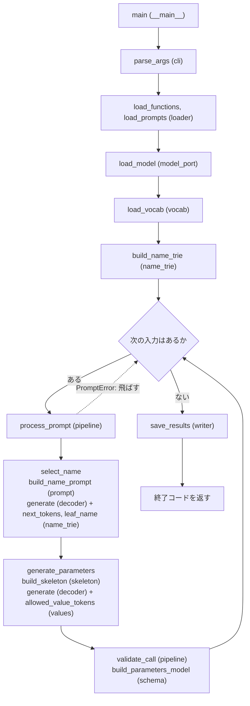

# アーキテクチャ(下書き)

状態: **下書き**。構成は暫定で、実装しながら変える。まず `src/` の直下に平らに置く(サブパッケージは作らない)。
決定の根拠は `docs/design/adr/` にある。この文書は「何がどこにあり、どの順で呼ばれるか」を書く。

記号は `docs/subject-v1.7.md` と同じ(【明文】【解釈】【設計判断】【測定】)。

## 1. Subject のコード規則(実装が必ず守るもの)
`docs/subject-v1.7.md` の第1章から、コードに直接かかわるものを移した。出典の章番号は原文のもの。

- 【明文】Python 3.10 以上。flake8 準拠。変数・引数・戻り値に型ヒント。全関数で mypy エラーなし(IV.1)。
- 【明文】関数とクラスに PEP 257 の docstring(IV.1)。
- 【明文】例外を適切に処理する。未処理の例外でクラッシュしたら「動作しない」扱い。資源はコンテキスト
  マネージャ等で確実に解放する(IV.1)。
- 【明文】**すべてのクラスは、検証に pydantic を使う**(IV.3.1、原文 "All classes must use pydantic for
  validation.")。【解釈】「pydantic のモデルであれ」とまでは書いていない。
- 【明文】使ってよいパッケージは `numpy` と `json`(IV.3.1)。
- 【明文】`pytorch`、`transformers`、`huggingface` 系、`outlines`、`dspy` 類は禁止(IV.3.1)。
  【解釈】プロジェクト自身のコードが直接使うことの禁止。SDK 経由は許容(`docs/subject-v1.7.md` 第1章)。
  **`src` から `import torch` しない。**(ユーザー、2026-11-09。当然のこととして守る)
- 【明文】関数の選択は LLM が行う。ヒューリスティクスは不可(IV.3.1)。
- 【明文】`llm_sdk` の private なメソッド・属性は使わない(IV.3.1)。使える公開 API は
  `encode`、`decode`、`get_logits_from_input_ids`、`get_path_to_vocab_file`(V.3.1)。
- 【明文】constrained decoding で 100% 有効な JSON を保証する。無効トークンの logits を負の無限大にして、
  残りから選ぶ。プロンプトだけに頼らない(V.1、V.3.3)。
- 【明文】出力は `data/output/function_calls.json`。各要素のキーはちょうど `prompt`、`name`、`parameters`
  (V.4)。入力不正とファイル欠落は適切に処理する(V.2、V.5)。
- 【明文】実行は `uv run python -m src [--functions_definition <file>] [--input <file>] [--output <file>]`
  (IV.3.2)。
- 【明文】レビューでは別のプロンプトと別の関数セットが使われる(V.2)。

## 2. 今日決まったこと(ユーザー、2026-11-09)
- 【設計判断】**出力先の既定は `data/output/`**(既定ファイル名は `function_calls.json`)。Subject の記述が
  曖昧なので、最も明確な解釈を採る。
- 【設計判断】関数名の trie は**トークン単位**で作る(ADR-0001 の案 a のとおり。各名前を `encode` した
  トークン列を木にする)。木の終端は名前のトークン列の最後(葉)とし、葉に着いたら選択を打ち切って、
  後ろの `",` 以降は骨組みとして強制する(ユーザーの指摘、2026-11-09。下の【測定】で、サンプルでは問題なし)。
  起動時に「名前だけの列が、名前 + `",` の列の接頭辞か」を確かめ、違う名前があればエラーにする。
- 【設計判断】実装は**小さな単位ごとの監査をせず、まとめて進める**。理由: AI の文脈を保てる。1つずつ
  監査すると、前の変更を直したくなったときに手間が増える。(`AGENTS.md` の工程 5 を直した)
- 【設計判断】スケルトン(関数の形だけのコード)は別ブランチ・別 PR で作る。PR を境目にする。
- 【設計判断】**モデルのポートは `typing.Protocol` にする。** 原文は「検証に pydantic を使う」で、モデルである
  ことまでは求めていない。ポートの入出力と設定は pydantic で検証する。例外クラスも、持たせるデータを pydantic で
  検証する形で足りるとみなす。リスク: レビュアーの読み方は確かめられない。
- 出力先、名前の木、ポート、`import torch` の禁止は、`docs/design/adr/0011-name-trie-and-output-path.md` に記録した。

### 【測定】トークン化(2026-11-09、SDK のトークナイザー、サンプルの関数 5 つ)
- 骨組み `{"prompt": "...", "name": "` の直後に名前を続けても、骨組み側のトークンは変わらなかった。
- 名前 + 閉じ引用符を、文脈の中でエンコードした結果と、単独でエンコードした結果は、5 つとも同じだった。
- **`",`(閉じ引用符 + カンマ)は 1 つのトークン**になる。ただし、名前だけをエンコードした列は、名前 + `"`、
  名前 + `",`、名前 + `", "parameters": {` のどれをエンコードした列の接頭辞にもなっていた(5 つとも。
  追加の測定)。このため、名前の木は名前だけで作り、葉で打ち切ってよい。
- 語彙 151643 のうち、引用符と他の文字を含むトークンは 1343 個。
- 限界: 5 つのサンプル名だけ。レビューの関数名では確かめていない。トークン列は 1 つの正規の分割だけを許す
  (別の分割は許さない)。

## 3. ファイル構成(暫定・平ら)
```
src/
  __main__.py   入口。引数を読み、実行し、終了コードを返す
  cli.py        引数の定義と検証(pydantic)
  loader.py     functions_definition.json と入力 JSON の読み込み・検証
  schema.py     pydantic のモデル: 関数定義、出力 1 件、型名。引数の事後検証用モデルを動的に作る
  model_port.py モデルの境界。SDK を import するのはこのファイルだけ
  vocab.py      語彙ファイルの読み込み。トークン ID と文字列の対応
  name_trie.py  関数名のトークン列の木。接頭辞の衝突は終端(閉じ引用符 + 後続)で解く
  skeleton.py   関数定義から、強制する骨組み(キー、記号)と値の位置を組み立てる
  values.py     値の型ごとの許可トークン(number、string、boolean)
  decoder.py    制約付きデコードの共通ループ(マスク、貪欲選択、強制トークン)
  prompt.py     プロンプトの組み立て(差し替え可能な設定)
  pipeline.py   1 件の処理: 関数名の選択 → 骨組み → 値の生成 → 組み立て → 検証
  writer.py     出力の保存(1 件ずつ原子的に)
  errors.py     エラーの種類とメッセージ
tests/          fake モデル(固定 logits)を使うテスト。モデルの読み込みはしない
```
- 【設計判断】平らに置くのは、早い段階で大きな構成を決めないため。育ったら、まとまりごとに分ける。
- 【設計判断】SDK に触れるのは `model_port.py` だけ。それ以外は、ポートの先が fake でも本物でも同じに動く。

## 4. 実行順(どの関数がどの順で呼ばれるか)
1. `__main__` が `cli` で引数を検証する。
2. `loader` が関数定義と入力を読んで検証する(空、重複、名前の接頭辞の衝突、未対応の型は起動時エラー)。
3. `model_port` がモデルを作る。モデルの確認(ADR-0007)をここで行う。
4. `vocab` が語彙を読み、`name_trie` が関数名の木を作る。
5. 入力 1 件ごとに `pipeline` が次を行う。
   1. `prompt` が関数選択用のプロンプトを作る。
   2. `decoder` と `name_trie` で関数名を選ぶ。候補が 1 つになったら残りのトークンを強制する。
   3. `skeleton` が、選んだ関数の骨組みを作る。
   4. 骨組みを強制しながら、値の位置で `values` の許可トークンだけを残して生成する。`prompt` は入力から
      コピーする。
   5. 組み立てた全文を JSON としてパースし、`schema` の動的モデルで検証する。
6. `writer` が 1 件ずつ保存する。失敗した件は飛ばし、標準エラーに理由を出し、最後に終了コードを非 0 にする。

### 実行順の図(スケルトンの関数名)
`括弧内` はファイル。`feat/skeleton` の `src/` の関数と対応している。



## 5. 未決(人が決める)
- 文字列の値の細部(ADR-0003)。実装後に決める。
- モデルの確認の細部(ADR-0007)。
